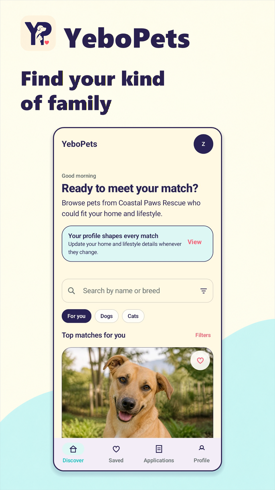
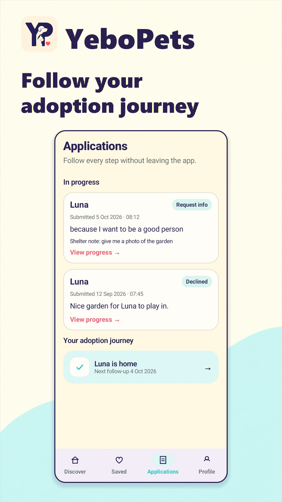
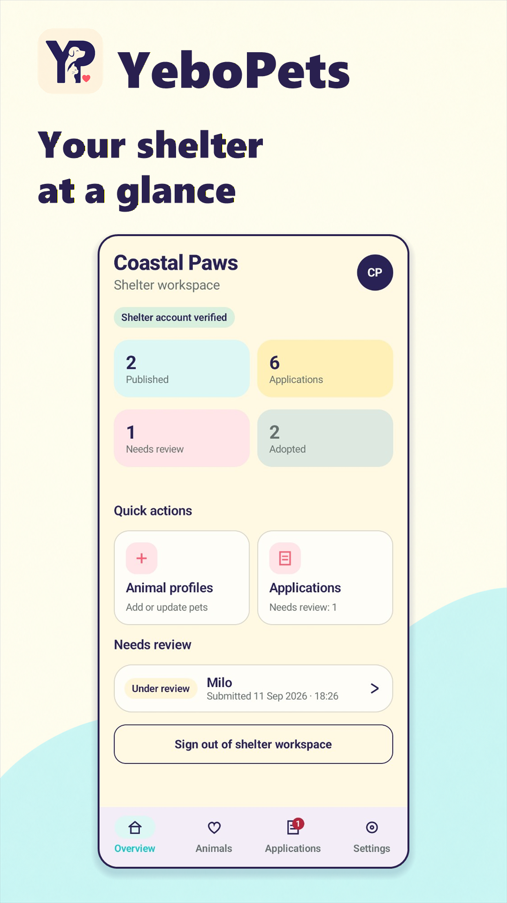
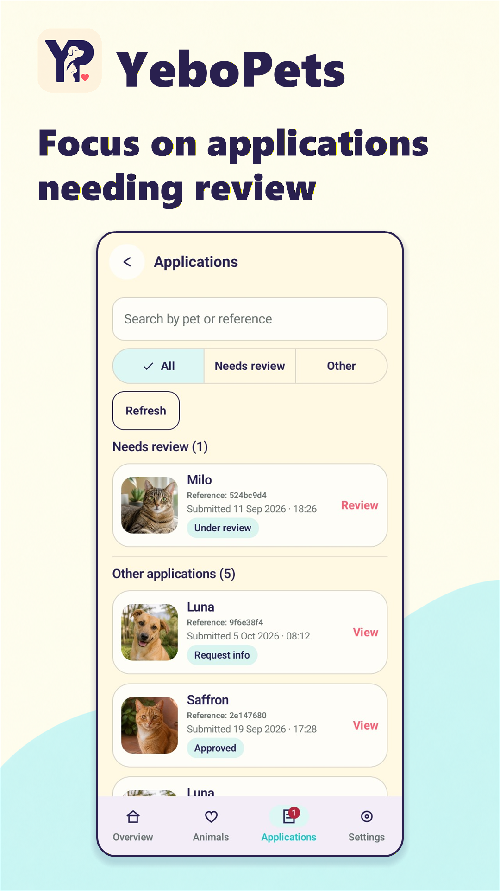
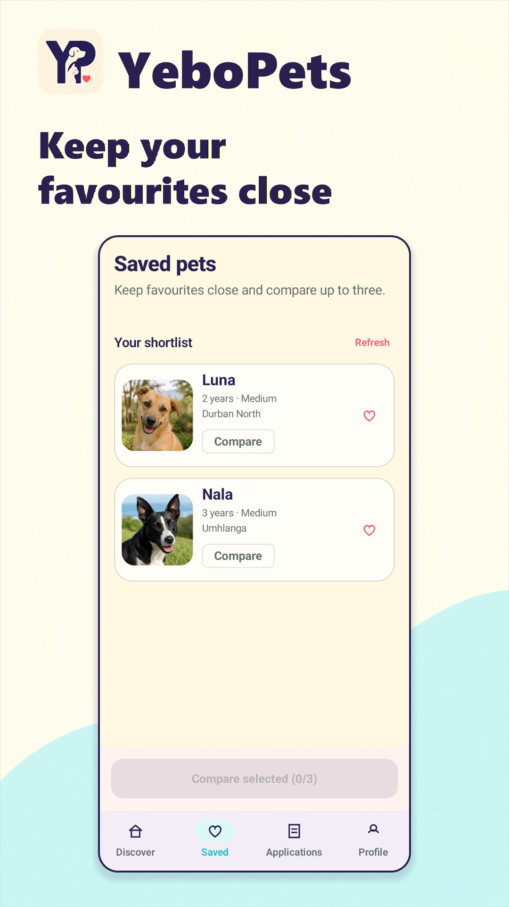
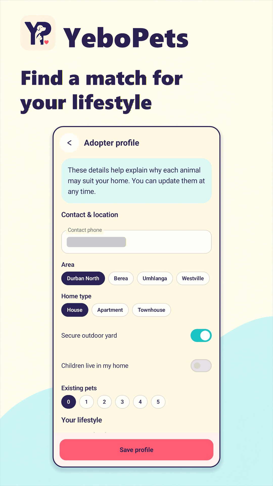
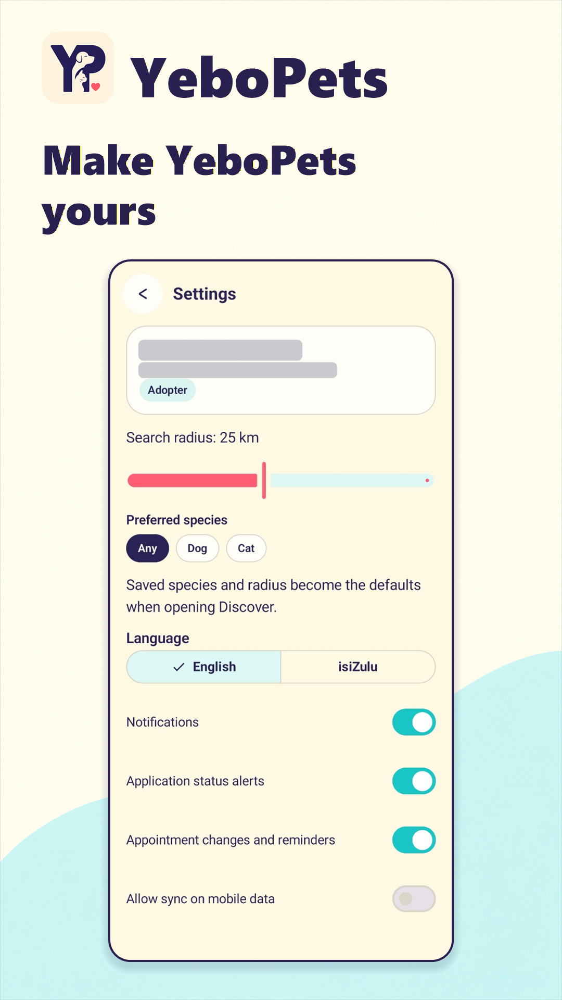
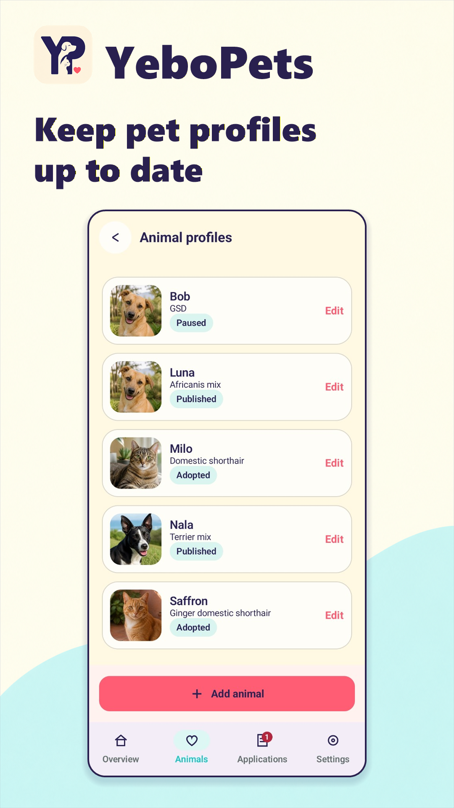
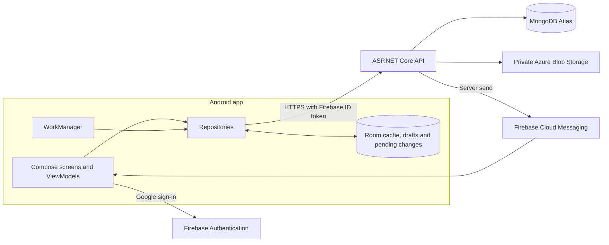

# YeboPets


A native Android app that helps people adopt pets from local shelters. Adopters build a profile, browse and compare pets with explainable compatibility scores, apply, and follow their adoption through visits and aftercare. Shelter staff manage animal listings and review applications in a separate workspace.

The app is written in Kotlin with Jetpack Compose and works offline for saved pets and application drafts. A custom ASP.NET Core API handles the business rules and connects Firebase-authenticated users to MongoDB and Azure Blob Storage.

Built by a team of four for PROG7314 at Emeris Durban North (2026).

**Demo video:** [Watch on YouTube](https://youtu.be/BD9olrDYSpg)

**Download:** the signed APK is attached to the [latest release](https://github.com/zenwyn-naicker/yebopets/releases/latest)

| Discover | Adoption journey | Shelter overview | Application reviews |
| :---: | :---: | :---: | :---: |
|  |  |  |  |

<details>
<summary>More screenshots</summary>

| Saved pets | Adopter profile | Settings | Animal profiles |
| :---: | :---: | :---: | :---: |
|  |  |  |  |

</details>

## Features

- **Google sign-in:** Firebase Authentication with Google single sign-on. The API decides which workspaces an account can use, and approved shelter staff can switch between adopter and staff views.
- **Matching and comparison:** filters, adopter profiles, compatibility scores that explain themselves, and side-by-side comparison of up to three pets.
- **Adoption journey:** applications, information requests, decisions, visit scheduling, adoption records and aftercare follow-ups.
- **Biometric unlock:** an optional strong-biometric prompt when returning to an existing session, with Google sign-in as the fallback.
- **Offline support:** account-scoped Room cache, a persistent queue of save and remove actions synchronised by WorkManager, and application drafts that survive navigation and failed submissions.
- **Push notifications:** application updates, appointment changes, visit reminders and follow-up alerts through Firebase Cloud Messaging, respecting each user's preferences.
- **English and isiZulu:** all app text is available in both languages, with a saved preference.
- **Private photos:** animal and follow-up photos are stored in a private Blob container and served only through authorised API calls.

The compatibility score weights household factors at 30%, lifestyle at 25%, preferences at 20%, experience at 15% and distance at 10%. It supports the shelter's decision rather than approving adoptions automatically.

## Tech stack

| Area | Technologies |
| --- | --- |
| Android | Kotlin, Jetpack Compose, ViewModels, Room, WorkManager, Retrofit, BiometricPrompt, Android 8.0+ (API 26) |
| Backend | C#, ASP.NET Core (.NET 10), Firebase Admin SDK |
| Data and services | MongoDB Atlas, Azure Blob Storage, Azure App Service, Firebase Authentication, Firebase Cloud Messaging |
| Testing | JUnit, Room and Compose UI tests, xUnit API tests against disposable MongoDB replica sets |
| CI | GitHub Actions |

## Architecture



- **Server-side identity:** the app sends a Firebase ID token with each request, and the API verifies it rather than trusting a client-supplied user ID. Staff access depends on an approved allowlist, not on what the client requests.
- **Offline-first sync:** a save or removal updates the screen and a persistent outbox together. WorkManager sends queued operations to `POST /api/sync` when the allowed network is available. Each operation carries a client operation ID and payload fingerprint, so retries after a lost response are never applied twice.
- **Retry policy:** network failures, `408`, `429` and server errors are retried; authentication failures keep pending work until the user signs in again.
- **Consistency:** finalising an adoption uses a MongoDB transaction, and unique indexes prevent duplicate active applications.
- **Media safety:** the app resizes and re-encodes photos, and the API checks size, format and full image decoding before storing them.

## Getting started

### Prerequisites

- Android Studio with Android SDK 36 and JDK 17
- .NET 10 SDK
- A Firebase project with Google sign-in and Cloud Messaging enabled
- A MongoDB replica set (for example, MongoDB Atlas) and an Azure Storage account

### Android app

1. Open the `YeboPets/` folder in Android Studio.
2. In Firebase, register the package `za.co.yebopets` with the SHA-1 and SHA-256 fingerprints of your debug or release key.
3. Place the Firebase config file at `YeboPets/app/google-services.json`.
4. Add these lines to `YeboPets/local.properties`, using the **web** OAuth client ID:

   ```properties
   API_BASE_URL=https://your-api-host/
   WEB_CLIENT_ID=your-web-oauth-client-id
   ```

5. Build and test:

   ```bash
   cd YeboPets
   ./gradlew assembleDebug testDebugUnitTest lintDebug
   ```

`google-services.json`, `local.properties` and signing keys are ignored by Git.

### API

The API reads its settings from environment variables or another private configuration source:

| Setting | Purpose |
| --- | --- |
| `Mongo__ConnectionString`, `Mongo__Database` | MongoDB connection and database name |
| `Firebase__ServiceAccountJson`, `Firebase__ProjectId` | Firebase Admin credentials and project |
| `StaffEmails__0`, `StaffEmails__1`, ... | Approved shelter-staff email addresses |
| `Push__Enabled` | `true` to send push notifications |
| `Blob__ConnectionString`, `Blob__Container` | Azure Storage connection and private media container |

```bash
dotnet restore api/YeboPets.Api.csproj
dotnet test api.Tests/YeboPets.Api.Tests.csproj -c Release
dotnet run --project api/YeboPets.Api.csproj
```

The health check is at `/health`. The tests start their own disposable MongoDB replica sets, so no cloud services are needed to run them.

## Testing

- **API:** 48 xUnit tests covering access control, workspace selection, sync idempotency, adoption finalisation and media validation.
- **Android:** 38 JVM tests plus Room and Compose UI instrumentation tests, covering biometric session isolation, queue ordering and HTTP behaviour. Run the instrumentation tests with `./gradlew connectedDebugAndroidTest` on a connected device.
- **CI:** the GitHub Actions workflow builds debug and release APKs, runs unit tests and lint, compiles the instrumentation tests and runs the API suite. It is set to run manually.

## Project structure

```text
YeboPets/      Android app (Kotlin, Jetpack Compose)
api/           ASP.NET Core API
api.Tests/     API, persistence and access-control tests
docs/          App icon and screenshots
```

## Team

| Member | Contribution |
| --- | --- |
| Khayden Chetty | Android configuration, biometric access, notifications, settings and localisation |
| Rivaan Kawulesar | API persistence, saved-state synchronisation, private media, push processing, API tests and the original app icon |
| Stephane Nsengiyumva | Room cache, pending operations, drafts, WorkManager retry and offline acceptance |
| Zenwyn Naicker | Shared screens, discovery, comparison, adoption journey, photo integration, tests, launcher icon and release documentation |

## Acknowledgements

Libraries, documentation and adapted implementation patterns are credited in [CODE_ATTRIBUTION.txt](CODE_ATTRIBUTION.txt).
